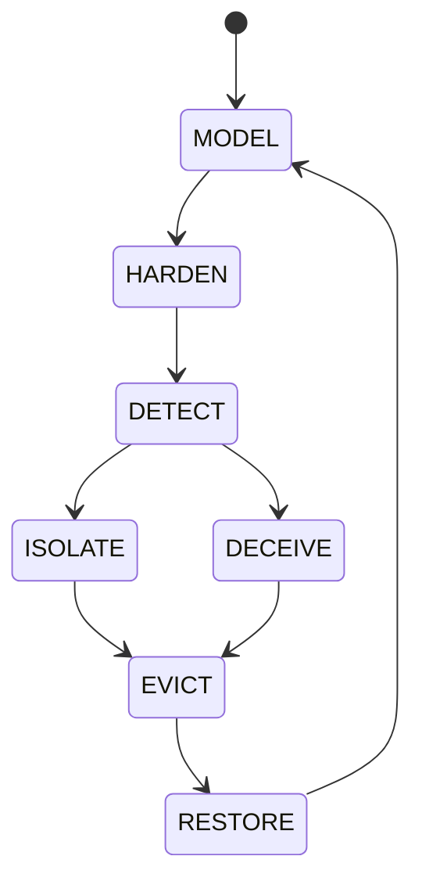

# CAI-EXPERT-LAB

**Cybersecurity Artificial Intelligence Framework** — a governance framework and
an executable **execution engine** for operating AI responsibly in cybersecurity,
including IT, OT/ICS, cloud and AI-enabled environments.

> Author and owner: **Antonio José Socorro Marín** — Creator of CAI-EXPERT-LAB®
> Copyright © 2025 Antonio José Socorro Marín. All rights reserved.
> Licensed under the **Reference-Only Governance Framework License v1.0** (see `LICENSE.md` and `/legal`).

> **Status: v0.1 — research preview.** The framework and the engine are published for
> review and evaluation; they are not yet complete. Corrections are made in public,
> one documented change at a time, and recorded in the commit history.

CAI-EXPERT-LAB turns AI governance from a document into something that **runs,
enforces its own rules, and proves what it did** — under two jurisdictions
(EU AI Act and USA NSM-22 / NIST), treated per critical-infrastructure sector.

## Where to find what

| What | Where |
|---|---|
| Framework core: definition, architecture, governance | [`docs/CORE/`](docs/CORE/) |
| Regional baselines | [`docs/USA/`](docs/USA/) · [`docs/EU/`](docs/EU/) |
| USA sector profiles | [`docs/USA/sectors/`](docs/USA/sectors/) |
| Applied labs (USA sectors, Mexico) | [`labs/`](labs/) |
| **Execution engine — Python source** | [`CAI-Engine/implementation/cai_engine/`](CAI-Engine/implementation/cai_engine/) |
| Engine guide: install, commands, MCP server | [`CAI-Engine/implementation/README.md`](CAI-Engine/implementation/README.md) |
| Ready-to-run examples | [`CAI-Engine/implementation/examples/`](CAI-Engine/implementation/examples/) |
| Automated tests | [`CAI-Engine/implementation/tests/`](CAI-Engine/implementation/tests/) |
| Engine design documents | [`CAI-Engine/`](CAI-Engine/) |
| Methodology · regulatory basis | [`METHODOLOGY.md`](METHODOLOGY.md) · [`REGULATORY-BASIS.md`](REGULATORY-BASIS.md) |
| License · legal notices | [`LICENSE.md`](LICENSE.md) · [`legal/`](legal/) |
| AI assistance and authorship policy | [`AI-GOVERNANCE.md`](AI-GOVERNANCE.md) |

---

## The seven-stage operational lifecycle

The framework and engine execute CAI as an explicit, guarded state machine.
Only the transitions below are valid; every other transition is blocked.



Each state has entry conditions, permitted actions, telemetry requirements,
safety constraints and exit criteria. No state is ever inferred.

---

## What makes it different

- **Governance that executes.** Policy, safety and human-authority constraints
  are enforced by the engine, not just described in documents.
- **AI is advisory only.** Low-confidence or non-explainable AI output cannot
  trigger an action, and AI can never force a state transition or bypass a gate.
- **Human authority is final.** High-risk / critical-infrastructure decisions
  require explicit, attributed human approval.
- **Hash-chained evidence.** Every decision is written to a hash-chained audit
  log; editing or deleting a single record is detected. Signing and external
  anchoring are not yet implemented.
- **Two jurisdictions, per sector.**
  - **EU** — EU AI Act (Regulation (EU) 2024/1689): risk tiers + article gates
    (Art. 5 / 9–15 / 50).
  - **USA** — NIST AI RMF, NIST AI 600-1 and the **NSM-22** critical-infrastructure
    sectors, each treated by its **SRMA** and consequence level, with OT/ICS
    safety gating.

> Alignment, not compliance: CAI-EXPERT-LAB maps to and enforces proportionate
> governance. It does not assert legal compliance, conformity assessment,
> certification or accreditation.

---

## Repository structure

```
docs/
  CORE/        definitions, lifecycle, state model, taxonomy, governance
  USA/         USA baseline + sectors/ (Energy, Nuclear, Healthcare, Financial, …)
  EU/          EU governance overlays and risk/proportionality model
  EXTERNAL/    white papers and foundational architecture
labs/          applied scenarios (Mexico, USA sectors, EU)
legal/         IP, ownership, commercial-use, attribution and confidentiality
CAI-Engine/              engine design documents
  implementation/        the executable engine (Python)
LICENSE.md     Reference-Only Governance Framework License v1.0
```

---

## The execution engine (quickstart)

The engine is in `CAI-Engine/implementation/`. The core is **pure Python
(3.11+), no dependencies**; only the optional MCP server needs `mcp`.

Running the engine is permitted only for private, non-commercial evaluation
and academic review, under Section 4A of `LICENSE.md`. Any operational,
production, or commercial use requires prior written authorization.

Install it as a package (adds the `cai-engine` command):

```bash
pip install "git+https://github.com/socorromipunto-eng/CAI-EXPERT-LAB.git#subdirectory=CAI-Engine/implementation"
cai-engine --help
```

Or run it from a copy of this repository:

```bash
cd CAI-Engine/implementation
python -m cai_engine init
python -m cai_engine status

# Govern an AI proposal before it acts (EU jurisdiction)
python -m cai_engine govern examples/ai_highrisk_energy.json        # HIGH -> human oversight (Art. 14)
python -m cai_engine govern examples/ai_prohibited.json             # Art. 5 -> blocked

# USA, treated per NSM-22 sector
python -m cai_engine govern examples/usa_energy.json                # Energy / SRMA: DOE -> human oversight
python -m cai_engine govern examples/usa_energy_lowconf.json        # below assurance floor -> blocked

# Verify the hash-chained evidence log
python -m cai_engine verify
```

It also runs as a **Model Context Protocol (MCP) server**, so an AI client
(e.g. Claude) must route its proposed actions through the governance runtime
before acting. See `CAI-Engine/implementation/README.md`.

---

## Status

Version 0.1 — research preview. The framework baseline (CORE / USA / EU, USA
sector profiles, labs) with a working, tested reference engine (cai-engine 0.4.2).
It is published for review and evaluation and is not yet complete. Standards evolve under
`docs/CORE/CAI-Core-Standards-Evolution-and-Governance.md`.

## Citation

> Socorro Marín, Antonio José. *CAI-EXPERT-LAB — Cybersecurity Artificial
> Intelligence Framework.* 2025. https://github.com/socorromipunto-eng/CAI-EXPERT-LAB

All permitted uses must clearly attribute authorship to
**Antonio José Socorro Marín — CAI-EXPERT-LAB**, as set out in `LICENSE.md`
and `/legal`.
