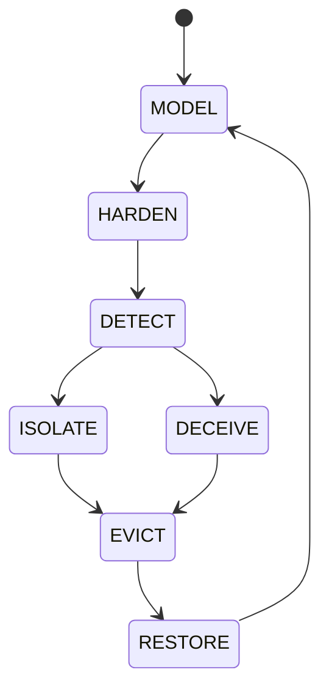

# CAI-EXPERT-LAB

[](https://github.com/socorromipunto-eng/CAI-EXPERT-LAB/actions/workflows/CAI-ENGINE-TESTS.yml)

**Cybersecurity Artificial Intelligence Framework** — a governance framework and
an executable **reference engine** for evaluating selected AI-governance
controls in cybersecurity, including IT, OT/ICS, cloud and AI-enabled scenarios.

> Author and owner: **Antonio José Socorro Marín** — Creator of CAI-EXPERT-LAB®
> Copyright © 2025 Antonio José Socorro Marín. All rights reserved.
> Licensed under the **Reference-Only Governance Framework License v1.0** (see `LICENSE.md` and `/legal`).

> **Status: v0.1 — research preview.** The framework and the engine are published for
> review and evaluation; they are not yet complete. Corrections are made in public,
> one documented change at a time, and recorded in the commit history.

CAI-EXPERT-LAB defines a governance reference framework. Its separate
reference engine evaluates submitted actions against implemented local gates
and records decisions in a hash-chained log with the limits stated below.
The repository includes EU and USA governance profiles and sector mappings;
these mappings do not establish regulatory compliance.

> **Implementation boundary (research preview).** CAI-EXPERT-LAB is the governance reference framework. `CAI-Engine/implementation/` is a separate reference implementation (cai-engine 0.4.2), subject to `LICENSE.md` Section 4A. The proposed MCP security architecture in `CAI-Engine/specifications/` must not be represented as an implemented security boundary. Design intent and implemented behavior require independent verification.

## Current reference-implementation limits

The framework version, engine package version and security-specification
version are separate. A correction kit version is not a framework release.
The reference engine records local decisions; an `EXECUTED` result does not
prove an external actuator ran. A `--by` label does not authenticate the
approver. Approval expiry, fact freshness across incidents and externally
anchored evidence remain unresolved. The local hash chain cannot detect every
tail truncation or whole-chain rewrite by a writer with sufficient access.
The seven strict expected-failure cases remain visible in the engine tests.
Their presence is not operational security approval.

The proposed security architecture must be reconciled and approved before
implementation. Neither local test results nor this clarification promotes a
new release or establishes certification or legal compliance.

## Where to find what

| What | Where |
|---|---|
| Framework core: definition, architecture, governance | [`docs/CORE/`](docs/CORE/) |
| Regional baselines | [`docs/USA/`](docs/USA/) · [`docs/EU/`](docs/EU/) |
| USA sector profiles | [`docs/USA/sectors/`](docs/USA/sectors/) |
| Applied labs (USA sectors, Mexico) | [`labs/`](labs/) |
| **Execution engine — Python source** | [`CAI-Engine/implementation/cai_engine/`](CAI-Engine/implementation/cai_engine/) |
| Engine guide: install, commands, MCP server | [`CAI-Engine/implementation/README.md`](CAI-Engine/implementation/README.md) |
| Ready-to-run examples | [`CAI-Engine/implementation/examples/`](CAI-Engine/implementation/examples/) |
| Automated tests | [`CAI-Engine/implementation/tests/`](CAI-Engine/implementation/tests/); configured for GitHub Actions on pushes to `main`, pull requests targeting `main`, and manual dispatch (Linux and Windows, Python 3.11 to 3.13). The badge above reports `main`, not the currently viewed review branch: [`.github/workflows/CAI-ENGINE-TESTS.yml`](.github/workflows/CAI-ENGINE-TESTS.yml) |
| Engine design documents | [`CAI-Engine/`](CAI-Engine/) |
| Engine security specification (proposed, pending owner approval): core and EU / USA profiles | [`CAI-Engine/specifications/`](CAI-Engine/specifications/) |
| Methodology · regulatory basis | [`METHODOLOGY.md`](METHODOLOGY.md) · [`REGULATORY-BASIS.md`](REGULATORY-BASIS.md) |
| License · legal notices | [`LICENSE.md`](LICENSE.md) · [`legal/`](legal/) |
| AI assistance and authorship policy | [`AI-GOVERNANCE.md`](AI-GOVERNANCE.md) |

---

## The seven-stage operational lifecycle

The seven stages and their order are the defensive tactics of
[MITRE D3FEND™](https://d3fend.mitre.org): Model, Harden, Detect, Isolate,
Deceive, Evict and Restore. CAI does not define these stages. What CAI adds
is the execution model built on them: entry conditions for each stage,
permitted action categories per stage, blocked transitions, and the
decision-integrity gates (DSA, ESA, D(t) and context drift) defined in
`docs/CORE/`.

The framework defines the lifecycle. The reference engine implements an
explicit state machine that checks the transitions shown below. Passing a local
transition check does not establish authenticated human authority, fresh facts
or execution by an external system; the limits above still apply.



Each state has entry conditions, permitted actions, telemetry requirements,
safety constraints and exit criteria. No state is ever inferred.

---

## What makes it different

- **Implemented local gates.** The reference engine evaluates policy and
  safety conditions for submitted actions and records approval labels. These
  labels do not authenticate an approver or establish authorization outside
  the reference runtime.
- **Advisory AI design.** Implemented confidence and explainability gates
  can reject submitted proposals. The runtime governs calls made through its
  interfaces; it cannot constrain a client acting through another path.
- **Human oversight requirement.** The framework requires human oversight.
  The reference engine can require an approval label for implemented escalation
  cases, but does not authenticate that person or establish approval expiry.
  The known missing-sector oversight case remains open.
- **Local hash-chain verification.** Verification checks hashes and links
  of the records present. It detects hash/link inconsistencies but does not
  establish completeness: tail removal, an absent log, or whole-chain rewriting
  may go undetected. Evidence-log signing and external anchoring are not
  implemented; signing a Git commit does not add those runtime controls.
- **Two jurisdictions, per sector.**
  - **EU** — EU AI Act (Regulation (EU) 2024/1689): risk tiers + article gates
    (Art. 5 / 9–15 / 50).
  - **USA** — NIST AI RMF, NIST AI 600-1 and the **NSM-22** critical-infrastructure
    sectors, each treated by its **SRMA** and consequence level, with OT/ICS
    safety gating.

> Governance mappings describe intended alignment; the reference engine
> implements a subset of local checks. Neither establishes legal compliance,
> conformity assessment, certification or accreditation.

---

## Repository structure

```
docs/
  CORE/        definitions, lifecycle, state model, taxonomy, governance
  USA/         USA baseline + sectors/ (Energy, Nuclear, Healthcare, Financial, …)
  EU/          EU governance overlays and risk/proportionality model
  EXTERNAL/    white papers and foundational architecture
labs/          applied scenarios (Mexico, USA sectors, EU)
legal/         IP, ownership, commercial-use, attribution and confidentiality
CAI-Engine/              engine design documents
  implementation/        the executable engine (Python)
LICENSE.md     Reference-Only Governance Framework License v1.0
```

---

## The execution engine (quickstart)

The engine is in `CAI-Engine/implementation/`. The core is **pure Python
(3.11+), no dependencies**; only the optional MCP server needs `mcp`.

Running the engine is permitted only for private, non-commercial evaluation
and academic review, under Section 4A of `LICENSE.md`. Any operational,
production, or commercial use requires prior written authorization.

For reproducible evaluation, the command below installs the reference-engine
snapshot from reviewed commit `16bba3d26bd75d45d48ef723ae1d3b9583ab73c3`
(adds the `cai-engine` command). This pins source provenance; it does not close
the known gaps or constitute a release or operational approval:

```bash
pip install "git+https://github.com/socorromipunto-eng/CAI-EXPERT-LAB.git@16bba3d26bd75d45d48ef723ae1d3b9583ab73c3#subdirectory=CAI-Engine/implementation"
cai-engine --help
```

Or run it from a copy of this repository:

```bash
cd CAI-Engine/implementation
python -m cai_engine init
python -m cai_engine status

# Govern an AI proposal before it acts (EU jurisdiction)
python -m cai_engine govern examples/ai_highrisk_energy.json        # HIGH -> human oversight (Art. 14)
python -m cai_engine govern examples/ai_prohibited.json             # Art. 5 -> blocked

# USA, treated per NSM-22 sector
python -m cai_engine govern examples/usa_energy.json                # Energy / SRMA: DOE -> human oversight
python -m cai_engine govern examples/usa_energy_lowconf.json        # below assurance floor -> blocked

# Verify the hash-chained evidence log
python -m cai_engine verify
```

It also runs as a **Model Context Protocol (MCP) server**, so an AI client
(e.g. Claude) can submit its proposed actions to the governance runtime before
acting. The server governs what is submitted to it; it cannot stop a client
that has other ways to act. See `CAI-Engine/implementation/README.md`.

---

## Status

Version 0.1 — research preview. The framework baseline (CORE / USA / EU, USA
sector profiles, labs) with a working, tested reference engine (cai-engine 0.4.2).
It is published for review and evaluation and is not yet complete. Standards evolve under
`docs/CORE/CAI-Core-Standards-Evolution-and-Governance.md`.

## Citation

> Socorro Marín, Antonio José. *CAI-EXPERT-LAB — Cybersecurity Artificial
> Intelligence Framework.* 2025. https://github.com/socorromipunto-eng/CAI-EXPERT-LAB

All permitted uses must clearly attribute authorship to
**Antonio José Socorro Marín — CAI-EXPERT-LAB**, as set out in `LICENSE.md`
and `/legal`.
