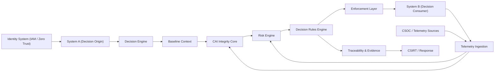
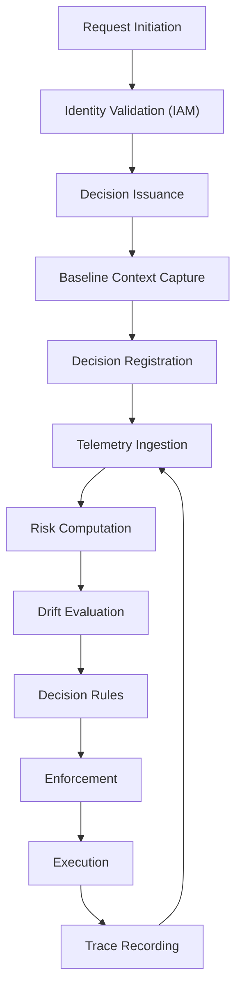
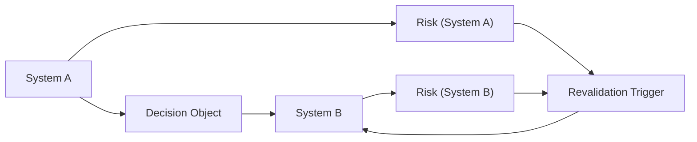
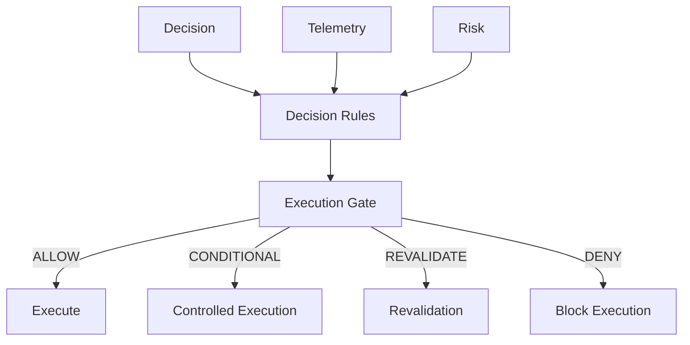

## 1. Purpose

This document defines the visual architecture of CAI (Cybersecurity Artificial Intelligence) within the APF cybersecurity environment.

Its objective is to provide a clear, structured, and system-level representation of how CAI components interact to enforce decision integrity across federated systems.

## 2. Architectural Overview

CAI operates as a cross-layer integrity system that connects:

- identity systems
- decision origin systems
- consuming systems
- telemetry sources
- risk evaluation
- enforcement mechanisms

The architecture is not hierarchical.

It is:

- a continuous integrity loop across system boundaries

## 3. High-Level Architecture Diagram

## 4. Decision Integrity Flow (Lifecycle View)

## 5. Cross-System Propagation Model

## 6. Enforcement Gate Model

## 7. Architectural Layers

### 7.1 Identity Layer

- IAM
- Zero Trust validation
- authentication signals

### 7.2 Decision Layer

- Decision issuance
- baseline context binding

### 7.3 Integrity Layer (CAI Core)

- telemetry ingestion
- drift evaluation
- risk computation
- decision rules

### 7.4 Enforcement Layer

- execution gating
- revocation
- conditional execution

### 7.5 Traceability Layer

- DecisionEvent logging
- EvidenceReference linkage
- audit reconstruction

### 7.6 Response Layer

- CSOC correlation
- CSIRT escalation

## 8. Key Architectural Properties

- continuous validation
- context-bound decisions
- deterministic evaluation
- cross-system consistency
- adversarial resilience

## 9. Strategic Insight

Traditional architectures:

- validate access at entry
- monitor after execution

CAI architecture:

- enforces integrity continuously across the entire decision lifecycle

## 10. Conclusion

This architecture demonstrates that CAI:

- is not a control layer
- is not a monitoring system
- is not a policy engine alone

It is:

- a continuous, system-wide decision integrity architecture